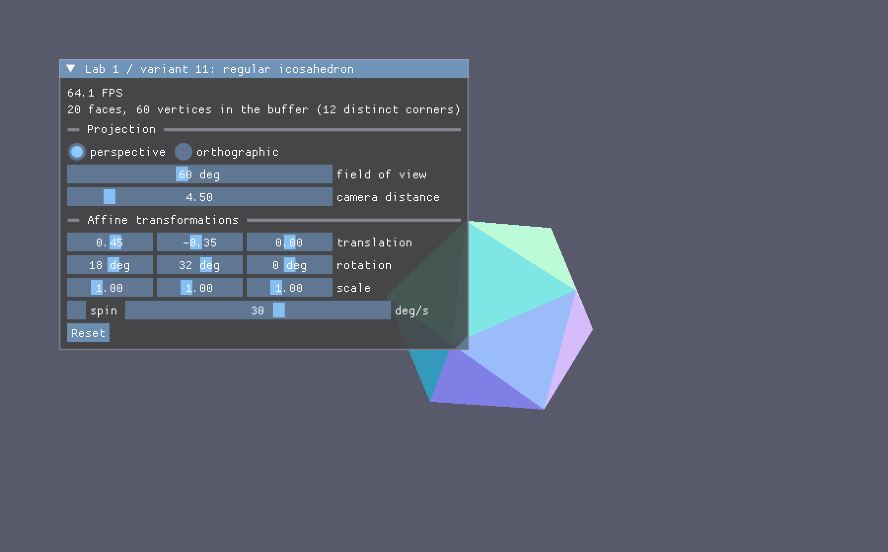
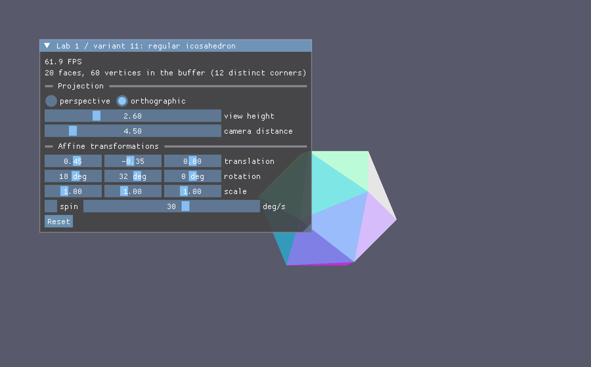
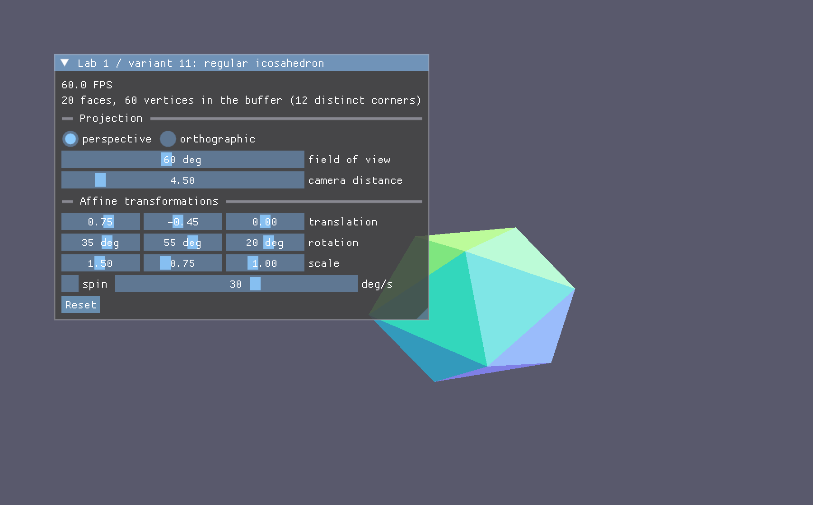

# ЛР 1. Основы 3D-графики

**Вариант 11 — правильный икосаэдр.** Выполнена базовая часть задания, без дополнительных заданий.

## Задание

Построить 3D-объект по варианту, спроецировать его на 2D-плоскость и научиться работать
с матрицами перспективной и ортографической проекции и аффинными преобразованиями.

Требования:

- Vulkan, GLFW и ImGUI (OpenGL и Direct3D 9/10/11 использовать нельзя);
- программа работает в реальном времени;
- проекцию и трансформации объекта можно менять динамически;
- объект корректно отрисовывается с учётом проекции.

## Что сделано

- Правильный икосаэдр: 12 вершин, 30 рёбер, 20 треугольных граней. Координаты вершин — это
  вершины трёх взаимно перпендикулярных «золотых» прямоугольников со сторонами 2 и 2φ,
  где φ = (1 + √5) / 2. Все рёбра равны 2, после нормировки фигура вписана в единичную сферу.
- В вершинном буфере грани развёрнуты в отдельные вершины (20 × 3 = 60), чтобы каждой грани
  задать свой цвет; цвет вычисляется процедурно по направлению на центр грани.
- Отрисовка с тестом глубины, матрица `MVP = P · V · M` пересчитывается каждый кадр и
  передаётся в вершинный шейдер через push-константы (64 байта), без наборов дескрипторов.
- Матрицы проекций записаны под систему координат Vulkan: глубина в диапазоне `[0, 1]`,
  ось Y направлена вниз.
- Интерфейс на ImGUI: переключение проекции, угол обзора или размер области видимости,
  расстояние до камеры, перенос, поворот и растяжение фигуры, автоматическое вращение.

## Результаты



Перспективная проекция. Видны 20 граней, каждая со своим цветом; грани задней стороны
скрыты тестом глубины.



Ортографическая проекция при тех же параметрах сцены: перспективного сокращения нет,
передние и задние грани сохраняют одинаковый масштаб.



Аффинные преобразования, заданные ползунками: перенос, поворот на (35°, 55°, 20°) и
неравномерное растяжение (1,5; 0,75; 1).

## Файлы

| Файл | Содержание |
| --- | --- |
| [308_Туймуков_Лаб1.docx](308_Туймуков_Лаб1.docx) | отчёт по шаблону курса |
| [screenshots/](screenshots/) | скриншоты работающей программы |
| [../source/linalg.hpp](../source/linalg.hpp) | векторы и матрицы 4 × 4: аффинные преобразования, `lookAt`, проекции |
| [../source/graphics.cpp](../source/graphics.cpp) | буферы через VMA и загрузка шейдерных модулей |
| [../source/application.cpp](../source/application.cpp) | геометрия икосаэдра, графический конвейер, интерфейс, отрисовка |
| [../shaders/object.vert](../shaders/object.vert), [../shaders/object.frag](../shaders/object.frag) | вершинный и фрагментный шейдеры |

Файлы `source/main.cpp` и `source/graphics_internal.*` оставлены без изменений относительно
стартового кода курса.

## Запуск

Из корня репозитория:

```bash
cmake --preset debug
cmake --build build-debug --parallel
./build-debug/vulkan-starter-app
```

Рабочий каталог при запуске должен быть корнем репозитория — шейдеры загружаются по
относительному пути `shaders/*.spv`.
